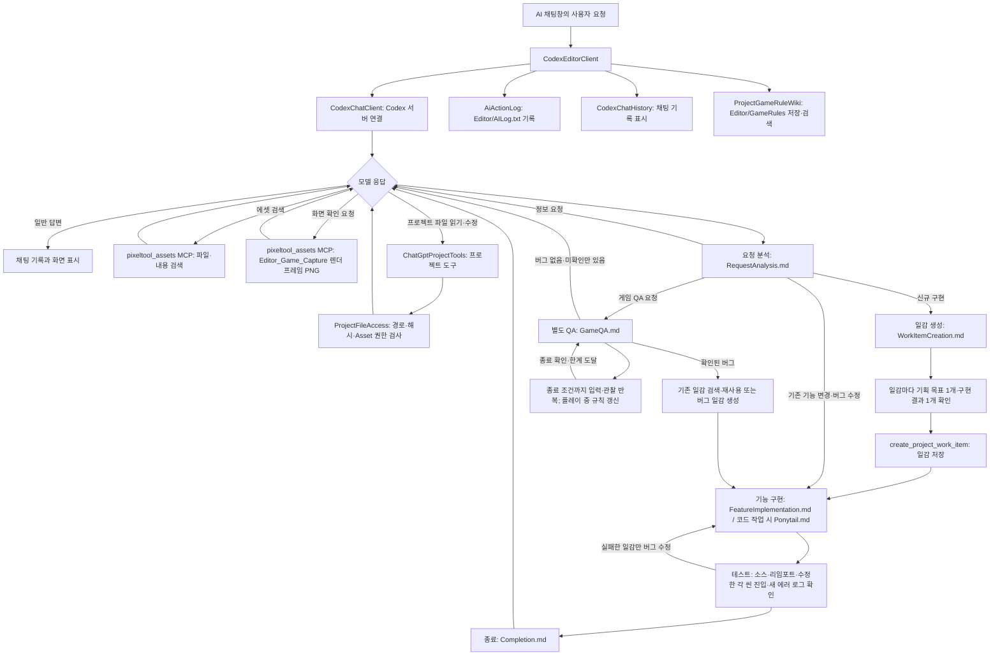

# Current PixelTool AI chat pipeline

This describes the current implementation on `main`. The runtime does not read this diagram as an instruction.

## Verified code paths

- `AIChatWindow` creates `CodexEditorClient`. It connects through `CodexChatClient` and adds `EngineGuide.Load()` and `CodexInstructions.Text` when starting or resuming a thread.
- Native tools are restricted to read-only operations; native write approvals are denied. Project changes use the dynamic `pixeltool` tools. The `pixeltool_assets` MCP only exposes Asset search tools.
- `ChatGptProjectTools` and `ProjectFileAccess` enforce project paths, hashes, and Asset permissions for file operations. Stop, project switch, and close use cancellation paths.
- Explicit game QA searches project game rules, saves each confirmed or inferred global/object/input rule under `Editor/GameRules`, and uses SHA256 when updating existing rule files. Wiki UI searches common documents, work items, and game rules separately or together.
- Dynamic project tools are registered when a CLI thread starts. `CodexChatHistory.CurrentToolSchemaVersion` advances when these definitions change, so the editor opens a new CLI thread while retaining prior chat messages and IDs; resuming an old thread would omit newly added tools.
- A confirmed QA bug is attached to a matching work item or saved as one new work item per defect, then routed through feature implementation and that item's test checks in the same request. Unverified findings remain in the QA report; blocked work items are retained.
- `CodexInstructions.Text` directs the model to load `RequestAnalysis.md` for every request. For new implementation it directs a pre-creation check that each work item has one planning goal and one independently verifiable result, then loads the implementation, test, and completion documents. These steps are model instructions, not semantic checks enforced by `create_project_work_item`.
- A complete read of `Ponytail.md` is recorded for the current turn. Repeated reads in that turn return a short already-read result; a new turn resets the record. This does not gate file edits or force the model to apply the guide.
- For explicit game QA, the instructions load `Skills/QA/GameQA.md` separately from work-item testing. `Editor_Game_Capture` is enabled in the AI chat's `pixeltool_assets` MCP allowlist and returns a requested Scene View PNG through MCP image content. It does not provide game-state snapshots, mouse input, or automatic visual polling.
- `Editor_Game_KeyInput` and the internal `test_game_key` accept 1-4 distinct keys for the same 1-120 rendered frames. A legacy single `key` remains valid. The QA path still lacks mouse input and game-state snapshots.
- The key tool also accepts `durationMs` (100-5000) for a real-time hold, avoiding very short high-FPS frame inputs. QA continues toward the game's observed terminal condition; a bounded time limit or concrete blocker yields an incomplete report, not a full-playthrough claim. New rules observed during play are saved to the project wiki.
- Tool results return to the model. Responses are shown in chat history and logged. Inspect the individual logging paths to determine which tool details are recorded.

## Keeping this diagram current

When changing the AI chat connection, instructions, tools, or pipeline, compare this diagram against the code and update it. From the repository root, run `pwsh -File PixelSolution/Check-AiPipelineDocs.ps1`. The script checks whether changes to known flow files include a diagram change. If a changed file does not affect the flow, review it and use `-AcknowledgeNoFlowChange`.

The check only detects co-changes. A human must verify that the diagram accurately describes the code and actual behavior. The diagram is not automatically synchronized with the implementation.
